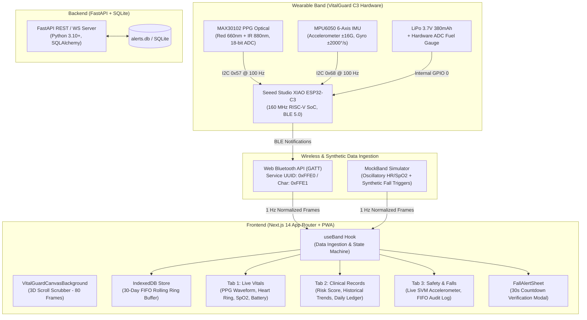
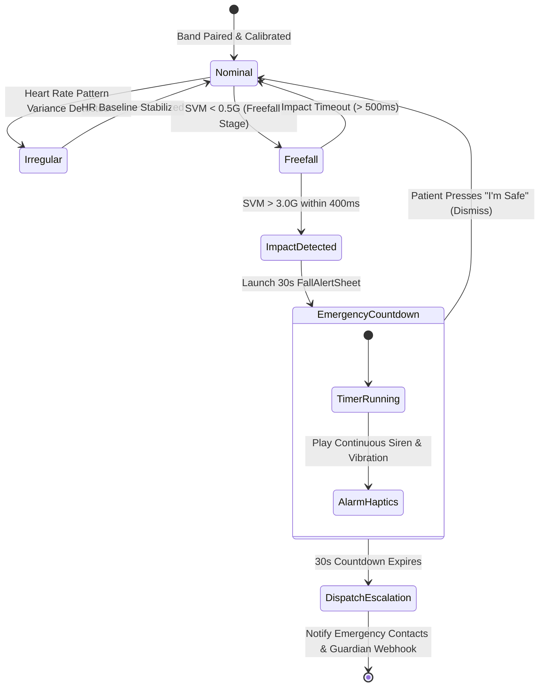

# VitalGuard C3 — Complete Codebase Context, Architecture & Systems Specification

> **Target Audience**: AI Coding Agents, LLMs, Embedded Systems Engineers, and Full-Stack Developers.  
> **System Designation**: VitalGuard C3 Autonomous Clinical Wearable Monitor & Telemetry Companion.  
> **Repository**: [Aditya1kumbhar/vitalguard-c3](https://github.com/Aditya1kumbhar/vitalguard-c3)  
> **Version**: 1.0.0-PROD  
> **Date**: October 2026  

---

## 1. Executive Summary & Clinical Mission

**VitalGuard C3** is a zero-latency, privacy-first clinical companion application and hardware monitoring platform designed for elderly, post-operative, and vulnerable patients. The ecosystem connects directly to the **Seeed Studio XIAO ESP32-C3** wearable biosensing band via **Web Bluetooth (BLE)** or low-overhead local telemetry streams.

### Core Tenets
1. **Zero Cloud Latency & Edge First**: All primary clinical fall detection thresholds, PPG signal processing, and 30-day historical trend retention operate on-device and in the local client browser (IndexedDB). No telemetry is blocked or dependent on remote cloud availability.
2. **Deterministic Emergency Verification**: Integrated 3-stage fall confirmation pipeline (Freefall $\to$ Impact Spike $\to$ Post-impact Immobility) paired with a 30-second haptic/audible emergency verification countdown modal.
3. **Calming Minimalist Aesthetics & 3D Scrollytelling**: An interactive 80-frame hardware unboxing and component explosion engine tied directly to page scroll, offering a calming, tactile unboxing feel while maintaining generous breathing room, high legibility, and WCAG AAA dual-theme contrast.

---

## 2. High-Level System Architecture



---

## 3. Hardware Architecture & Sensor Array

| Component | Part / Spec | Interface | Sampling / Bus | Clinical Function |
| :--- | :--- | :--- | :--- | :--- |
| **Microcontroller** | Seeed Studio XIAO ESP32-C3 | SoC | 160 MHz RISC-V, 400KB SRAM | Core firmware execution, BLE 5.0 peripheral advertising, GATT server. |
| **PPG Biosensor** | Analog Devices / Maxim MAX30102 | $\text{I}^2\text{C}$ (`0x57`) | 100 SPS internal, 1 Hz telemetry | Dual-wavelength photoplethysmography (Red 660nm, IR 880nm), SpO2% calculation, resting/active heart rate (BPM). |
| **6-Axis IMU** | InvenSense MPU6050 | $\text{I}^2\text{C}$ (`0x68`) | 100 Hz continuous polling | 3-axis Accelerometer ($\pm 16g$), 3-axis Gyroscope ($\pm 2000^\circ/\text{s}$), Signal Magnitude Vector ($\text{SVM}$). |
| **Battery & Power** | 3.7V 380mAh Rechargeable LiPo | GPIO 0 | 0.1 Hz ADC averaging | Power rail regulation, ultra-low power standby management, voltage telemetry. |

### Mathematical Sensor Models
1. **Signal Magnitude Vector (SVM)**:
   $$\text{SVM} = \sqrt{a_x^2 + a_y^2 + a_z^2}$$
   - **Nominal Rest**: $\approx 1.00\text{G} \pm 0.08\text{G}$ (Earth gravity baseline).
   - **Active Ambulatory**: $1.2\text{G} - 1.8\text{G}$.
   - **Critical Fall Threshold**: $\text{SVM} \ge 3.00\text{G}$ accompanied by preceding freefall ($\text{SVM} < 0.5\text{G}$).

2. **PPG Arterial Oxygen Saturation (SpO2)**:
   $$R = \frac{\left(\text{AC}_{\text{red}} / \text{DC}_{\text{red}}\right)}{\left(\text{AC}_{\text{ir}} / \text{DC}_{\text{ir}}\right)}, \quad \text{SpO}_2\% = 110 - 25 \times R$$

---

## 4. Frontend Architecture & Directory Hierarchy

The frontend is built on **Next.js 14 (App Router)**, **React 18**, **TypeScript**, **Tailwind CSS**, and **Framer Motion**, bundled with **Next-PWA** (`workbox`) for offline edge execution.

```
frontend/
├── app/
│   ├── components/
│   │   ├── ClinicalSummaryCard.tsx      # Longitudinal summary card
│   │   ├── GlassIcon.tsx                # Dynamic SVG icon renderer with variant glows
│   │   ├── GlassLogo.tsx                # Animated VitalGuard cyber-glass logo
│   │   ├── HistoricalTrends.tsx         # SVG line charts for multi-day vitals
│   │   ├── NavHeader.tsx                # Fixed header with status indicators
│   │   ├── PinPad.tsx                   # Secure 4-digit PIN authentication pad
│   │   ├── RiskScoreCard.tsx            # Clinical fall risk assessment index
│   │   ├── ThemeToggle.tsx              # Light / Dark mode toggle switch
│   │   └── VitalGuardCanvasBackground.tsx # Zero-latency 80-frame 3D scrollytelling background
│   ├── context/
│   │   ├── AuthContext.tsx              # Guardian auth state, device pairing, session tokens
│   │   ├── authDatabase.ts              # Local user credentials & PIN store
│   │   └── ThemeContext.tsx             # Dual-mode semantic color provider
│   ├── data/
│   │   ├── BandFrame.ts                 # Unified TypeScript interfaces for telemetry frames
│   │   ├── MockBand.ts                  # Synthetic telemetry transport (sinusoidal HR, SpO2)
│   │   ├── useBand.ts                   # React hook binding transport to state machine
│   │   └── WebBluetoothBand.ts          # Native Web Bluetooth GATT interface
│   ├── design/
│   │   ├── AmbientProvider.tsx          # Dynamic ambient background glow controller
│   │   ├── Card.tsx                     # Translucent cyber-glass card surface
│   │   ├── FallAlertSheet.tsx           # Full-screen 30-second emergency modal
│   │   ├── motion.tokens.ts             # Spring physics, haptics, and design constants
│   │   ├── PressableButton.tsx          # Accessible haptic-enabled button
│   │   ├── Ring.tsx                     # SVG circular gauge for Heart Rate & SpO2
│   │   └── Sheet.tsx                    # Bottom-sheet modal drawer
│   ├── feel-lab/page.tsx                # Sensory calibration & vibration testbed
│   ├── login/page.tsx                   # Guardian credential entry & device discovery
│   ├── privacy/page.tsx                 # Edge privacy policy & GDPR compliance
│   ├── records/page.tsx                 # Detailed daily clinical record explorer
│   ├── terms/page.tsx                   # Clinical device disclaimer & terms
│   ├── utils/
│   │   ├── api.ts                       # Axios client for optional backend sync
│   │   ├── haptics.ts                   # Navigator vibration engine (tap, click, alarm)
│   │   ├── localDatabase.ts             # Dexie / IndexedDB 30-day FIFO retention store
│   │   └── webauthn.ts                  # FIDO2 biometric authentication helpers
│   ├── globals.css                      # Semantic CSS variables & theme tokens
│   ├── layout.tsx                       # Root HTML shell with PWA metadata
│   └── page.tsx                         # Main Dashboard (Tabs: Vitals, Records, Safety)
└── public/
    ├── assets/vitalguard/exploded-frames/ # 80 full-range JPEG frames (frame_000.jpg to frame_079.jpg)
    ├── manifest.json                    # PWA Web App Manifest
    └── sw.js                            # Workbox Service Worker
```

---

## 5. 3D Interactive Hardware Scrollytelling Engine

Located in [`frontend/app/components/VitalGuardCanvasBackground.tsx`](file:///c:/Users/hp/Desktop/NXT/Vital-C3/frontend/app/components/VitalGuardCanvasBackground.tsx), the scrollytelling engine renders an exploded 3D view of the physical hardware band as the user scrolls.

### Implementation Principles
1. **Frame Range**: 80 full-range 1280x720 JPEG frames (`frame_000.jpg` to `frame_079.jpg`, 4.4 MB total), extracted from macro 3D CAD renders.
   - **Frame 0**: Closed, sleek smart band on dark ambient canvas.
   - **Frame 40**: Band chassis opening, Seeed Studio XIAO ESP32-C3 microcontroller lifting.
   - **Frame 79**: Full exploded perspective showing PCB, surface-mount ICs, PPG sensor array, LiPo battery, and retention bracket floating in 3D.
2. **Direct Synchronous Scrubbing**:
   ```typescript
   const progress = Math.min(1, Math.max(0, scrollY / maxScroll));
   const frameIndex = Math.min(totalFrames - 1, Math.max(0, Math.round(progress * (totalFrames - 1))));
   drawFrame(frameIndex);
   ```
   - Avoids flaky `requestAnimationFrame` render loops that stall in background tabs or throttled Chromium workers.
   - Each scroll tick triggers instant `<canvas>` 2D context redraw in under $0.1\text{ms}$.
3. **Graceful Fallback & GPU Textures**:
   - Uses `Image.prototype.decode()` to upload textures directly to GPU memory.
   - If a specific frame is still decoding, dynamically falls back to the nearest loaded neighbor frame so the viewport never flickers or turns blank.
4. **Universal Active Routes**:
   - Active across all three core tabs (`summary` / Vitals, `trends` / Records, `falls` / Safety).
   - **Strictly Excluded**: Never loaded on public unauthenticated views (`/login`, `/privacy`, `/terms`).

---

## 6. Telemetry Protocol & Data Structures

### Telemetry Frame Specification (`BandFrame.ts`)
```typescript
export interface BandFrame {
  ts: number;          // Unix epoch timestamp (ms)
  hr: number;          // Heart Rate in Beats Per Minute (40 - 220)
  spo2: number;        // Blood Oxygen Saturation Percentage (70 - 100)
  battery: number;     // Battery State of Charge Percentage (0 - 100)
  accelX: number;      // Acceleration X-axis (G-force)
  accelY: number;      // Acceleration Y-axis (G-force)
  accelZ: number;      // Acceleration Z-axis (G-force)
  svm: number;         // Signal Vector Magnitude (G-force)
  fallStatus: boolean; // Flag indicating acute fall impact trigger
}
```

### Web Bluetooth GATT Specification
- **Primary Service UUID**: `0000FFE0-0000-1000-8000-00805F9B34FB` (Short: `0xFFE0`)
- **Characteristic UUID**: `0000FFE1-0000-1000-8000-00805F9B34FB` (Short: `0xFFE1`)
- **Properties**: `READ`, `NOTIFY`
- **Binary Packet Format (8 Bytes)**:
  `[0:1]` HR uint8, `[1:2]` SpO2 uint8, `[2:3]` Battery uint8, `[3:5]` SVM int16 (scale 100), `[5:6]` FallFlag uint8, `[6:8]` Checksum uint16.

---

## 7. 30-Day FIFO Local Storage Engine (`localDatabase.ts`)

To ensure HIPAA/GDPR clinical compliance and offline resilience, historical records are stored locally using IndexedDB.

### Storage Rules
1. **FIFO Ring Buffer**: Retains strictly the most recent 30 chronological days of records (`YYYY-MM-DD`).
2. **Deterministic Auto-Purging**: Whenever a record with day index $>30$ is inserted, days $< (N-30)$ are automatically pruned from the table.
3. **IndexedDB Schema**:
   - Table `daily_records`: Primary key `dateKey` (`string`).
   - Fields: `avg_hr` (`number`), `avg_spo2` (`number`), `fall_count` (`number`), `total_readings` (`number`), `risk_level` (`string`).

---

## 8. Emergency Fall Verification State Machine



---

## 9. Backend Services & REST API Specification

The companion Python service is built using **FastAPI** and **SQLAlchemy** over **SQLite** (`alerts.db`).

### Primary API Endpoints
| Method | Route | Description |
| :--- | :--- | :--- |
| `GET` | `/` | API status healthcheck & version ping. |
| `POST` | `/api/auth/login` | Authenticate Guardian session and retrieve JWT bearer token. |
| `GET` | `/api/telemetry/latest` | Retrieve the latest real-time frame ingested from paired hardware. |
| `POST` | `/api/telemetry/ingest` | Ingest raw telemetry packet from ESP32 BLE gateway or proxy. |
| `GET` | `/api/records/30-day` | Query 30-day aggregated physiological records and fall history. |
| `POST` | `/api/alerts/fall` | Record emergency fall incident and trigger external alert dispatch. |
| `POST` | `/api/alerts/dismiss` | Log patient dismissal ("I'm Safe") within the 30-second window. |
| `GET` | `/api/analytics/risk-score`| Compute multi-factor clinical fall risk score (0–100 scale). |

---

## 10. Strict Behavioral Constraints & Prohibitions

For any AI models or developers contributing to this codebase, the following rules are **strictly enforced**:

1. **Explicitly Banned Subtitle Strings**:
   Never add the following three text strings anywhere in the application:
   - ❌ `"Real-time telemetry and continuous health monitoring streamed from VitalGuard C3."`
   - ❌ `"Longitudinal physiological telemetry and cardiovascular trend analysis."`
   - ❌ `"Continuous 6-axis MPU6050 Signal Magnitude Vector (SVM) impact surveillance."`
2. **Zero Public Route Backgrounds**:
   The 3D interactive hardware scrollytelling background must **never** be rendered on public routes (`/login`, `/privacy`, `/terms`). It is strictly gated to authenticated sessions.
3. **No Fluff or Speculative Cards**:
   Keep the main dashboard clean and focused purely on core clinical telemetry. Do not add bulky hardware spec tables or technical status blocks back to the primary tabs.
4. **Preserve Web Bluetooth & MockBand**:
   Do not modify the Web Bluetooth GATT service or MockBand oscillation generator in ways that break compatibility with the physical Seeed Studio XIAO ESP32-C3 hardware firmware.
